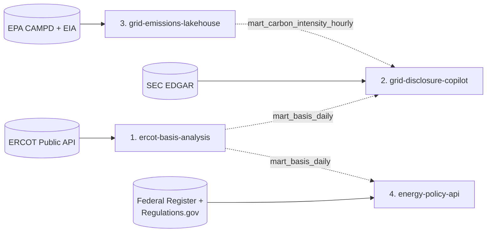

# Portfolio architecture

Four end-to-end projects, each closing a distinct set of skills, built so they
reinforce each other without depending on each other.

| # | Project | Closes | Public dataset | Status |
| - | --- | --- | --- | --- |
| 1 | [`ercot-basis-analysis`](../../ercot-basis-analysis) | ERCOT / power markets, Energy modeling, ETL / data pipelines | ERCOT Public API | Pipeline built and tested, not yet run on real data; see [gap analysis](GAP_ANALYSIS.md) |
| 2 | [`grid-disclosure-copilot`](../../grid-disclosure-copilot) | Azure, RAG / agents, Airflow / orchestration | SEC EDGAR filings | Architecture only |
| 3 | [`grid-emissions-lakehouse`](../../grid-emissions-lakehouse) | Spark, Data quality / governance, GCP | EPA CAMPD hourly emissions + EIA | Architecture only |
| 4 | [`energy-policy-api`](../../energy-policy-api) | Databricks, REST / GraphQL APIs, Regulatory & policy | Federal Register + Regulations.gov | Architecture only |

"Architecture only" means a README, an `ARCHITECTURE.md` with the decisions
still to make, and an empty directory skeleton. No pipeline code exists yet.

## Design principles

1. **One domain thread, four different datasets.** Everything concerns the
   Texas / U.S. power sector (markets, disclosures, emissions, policy), so a
   reviewer sees one coherent story. Each project still uses a different
   public dataset and a different core platform, so none is a re-skin of
   another.
2. **Independent by default, connected by contract.** Every project runs on
   its own, including tests and CI, using small committed sample data and no
   credentials. Cross-project links are optional and go through a documented
   table schema, never through shared code.
3. **Every claimed skill has a proof artifact** a reviewer can open in under a
   minute (see the matrix below).
4. **Honest scope.** Where the platform is overkill for the data (Spark on a
   dataset BigQuery could handle, Databricks Free Edition limits), the
   write-up says so and measures it. That reads as judgement, not padding.
5. **Free-tier first, with cost guardrails.** Each project documents its
   cloud cost, sets a budget alert, and ships a teardown path.

## How they fit together



Dotted edges are optional. Each is one read-only table:

| Contract | Producer | Consumer | Used for |
| --- | --- | --- | --- |
| `mart_basis_daily` | 1 | 2 | The copilot's read-only SQL tool: "what was basis at node X last winter?" next to what filings say |
| `mart_basis_daily` | 1 | 4 | Descriptive event windows around regulatory / market-rule events |
| `mart_carbon_intensity_hourly` | 3 | 2 | A second SQL tool: emissions context for filing claims |

`mart_basis_daily` does not exist yet; the gap analysis proposes its columns,
derived from project 1's existing `basis` table. Draft schemas live with their
producer and are versioned there. Consumers must
treat a missing table as "feature off", not as an error.

## Skills coverage matrix

Each tag from the objective list, with the artifact that proves it.

| Skill tag | Project | Proof artifact |
| --- | --- | --- |
| ERCOT / power markets | 1 | Basis definition in `ASSUMPTIONS.md`; DAM/RT basis marts; RTC+B break handled in the write-up |
| Energy modeling | 1 | Battery dispatch model (built) and shadow-price congestion attribution (not yet built), with documented assumptions |
| ETL / data pipelines | 1 (also 3) | Idempotent resumable loads with manifest, preflight, quality reports, tests; CI still to add |
| Azure | 2 | Bicep-deployed Container Apps + AI Search + Blob + OpenAI, managed identity, Key Vault, tracing |
| RAG / agents | 2 | Hybrid retrieval with citations; tool-using agent; an evaluation harness with a golden set and published metrics |
| Airflow / orchestration | 2 | DAGs for ingest → parse → index → evaluate, idempotent and backfillable, with run screenshots |
| Spark | 3 | Bronze/silver/gold PySpark jobs on Dataproc Serverless, with a Spark-vs-BigQuery benchmark |
| Data quality / governance | 3 | YAML data contracts, quarantine tables with reason codes, Dataplex scans, lineage, a DQ scorecard |
| GCP | 3 | Terraform for GCS, BigQuery, Dataproc, Dataplex, IAM; budget alert |
| Databricks | 4 | Unity Catalog + Delta + declarative pipelines, deployed by a Databricks Asset Bundle |
| REST / GraphQL APIs | 4 | One service layer behind both `/v1` REST and `/graphql`; cursor pagination, auth, rate limits, contract tests |
| Regulatory & policy | 4 | Policy primers for 2–3 case-study events, taxonomy of regulatory event types, and what the data can and cannot show |

## Role coverage

| Target role | Strongest projects | Note |
| --- | --- | --- |
| Energy Analyst | 1, 4, 3 | Markets and modeling (1), policy-to-market (4), emissions context (3) |
| Sustainability data engineer | 3, 2, 4, 1 | Governed pipelines (3), unstructured disclosure data (2), policy datasets (4), ETL (1) |
| Climate ML engineer | 2, 3 | RAG/agent evaluation (2); feature-ready emissions marts (3) |

**One gap worth knowing about.** None of the four "Closes" lists names
predictive modeling, yet *Climate ML engineer* is a listed role. The cheapest
fix is already in the plan: `grid-emissions-lakehouse` has a stretch goal for
a weather-driven carbon-intensity baseline forecast with a proper backtest,
and project 1's congestion attribution would add estimation work. If ML roles matter most, promote
that stretch goal.

## Sequencing

The list order (1 → 2 → 3 → 4) works; nothing hard-blocks reordering because
every cross-link is optional.

```
Weeks 1-2    Project 1: run it on real data and write it up (the pipeline is built)
Weeks 3-5    Project 2
Weeks 6-8    Project 3
Weeks 9-11  Project 4
```

Soft dependencies worth planning around:

- Build project 1's `mart_basis_daily` before projects 2 and 4 need it, or
  stub it with a sample file. Project 1's real-data run is also the critical
  path for its own write-up, so it comes first.
- Project 3's data-quality patterns can be retrofitted into project 1 if built
  first. Swapping 2 and 3 is reasonable if data quality matters more than RAG.
- Project 4's Free Edition constraints may force an external ingest path; read
  its `ARCHITECTURE.md` before starting.

## Facts to re-verify before building

These came from searches during planning and may change; confirm against the
official page before relying on them.

- Databricks Free Edition limits and naming (serverless only; limits on
  pipelines, apps, SQL warehouse, and outbound internet).
- Azure AI Search free-tier limits and which ranking features it lacks.
- Dataplex naming (docs now say Knowledge Catalog) and Spark lineage setup.
- CAMPD bulk-file layout and API key requirements.
- Regulations.gov API v4 rate limits (1,000 requests/hour per key was
  reported).
