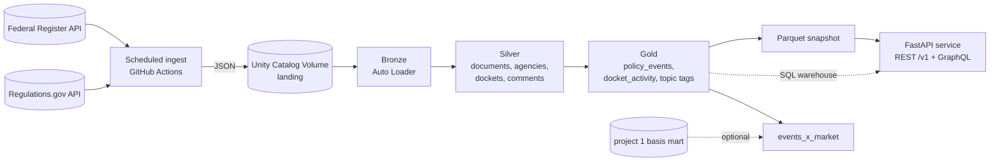

# energy-policy-api

> **Status: architecture only.** This directory holds the design and an empty
> skeleton. No pipeline or API code exists yet. Everything under "Planned" is
> a plan.

A Databricks lakehouse of U.S. energy-sector regulatory activity (rules,
notices, dockets, public comments), served through one service layer as both a
**REST** and a **GraphQL** API, with a small set of **policy case studies**
that connect regulatory events to what the data can and cannot say about
markets.

**Closes:** Databricks · REST / GraphQL APIs · Regulatory & policy
**Dataset:** [Federal Register API](https://www.federalregister.gov/developers/documentation/api/v1)
and [Regulations.gov API](https://open.gsa.gov/api/regulationsgov/)
**Helps:** Climate ML engineer · Sustainability data engineer

## Why this project

Regulatory data is messy in useful ways: documents amend each other, dockets
span years, comment volume is lumpy, and the interesting question ("what
changed, who is affected, through what mechanism?") needs domain judgement,
not just ingestion. The API half shows service design (pagination, auth,
versioning, contracts); the policy half shows the judgement to use it
responsibly, including saying when the data cannot support a causal claim.

## Planned architecture (summary)

Details, open decisions, and the Free Edition constraints that shape the
design are in [`ARCHITECTURE.md`](ARCHITECTURE.md).

## Planned deliverables

- [ ] Databricks Asset Bundle deploying ingestion, pipelines, and jobs
- [ ] Unity Catalog bronze/silver/gold tables built by declarative pipelines
- [ ] Topic and event-type tagging with a measured precision on an audited sample
- [ ] FastAPI service: REST `/v1` and `/graphql` over one service layer
- [ ] Cursor pagination, API keys, rate limits, error model, OpenAPI, contract tests
- [ ] 2-3 policy case studies in `docs/policy/`
- [ ] `reports/writeup.md` and a demo (hosted API with docs, or screenshots)

## Planned 3-week milestones

| Week | Goal | Exit criteria |
| --- | --- | --- |
| 1 | Ingest, bronze, silver, bundle | Federal Register + Regulations.gov land and normalize; bundle deploys; tests run on `data/sample` with no Databricks |
| 2 | Gold, tagging, REST | Gold tables built; tagging precision measured; `/v1` endpoints with pagination, auth, and OpenAPI |
| 3 | GraphQL, contracts, case studies | `/graphql` on the same services; contract tests in CI; case studies and write-up; demo or screenshots |

## Planned layout

| Path | Contents |
| --- | --- |
| `databricks/` | Asset Bundle config, resources, and bronze/silver/gold pipeline code |
| `src/ingest` | API clients for ingestion (retry, pagination, rate limits) |
| `src/nlp` | Topic and event-type tagging |
| `src/api/services` | Business logic shared by both APIs |
| `src/api/rest`, `src/api/graphql` | Thin adapters over the services |
| `tests/unit`, `tests/contract` | Unit tests and API contract tests |
| `data/sample` | Small committed fixture |
| `docs/policy` | Policy primers and case studies |
| `docs/decisions` | ADRs |
| `reports` | Write-up |

Assumptions and methodology are recorded in [`ASSUMPTIONS.md`](ASSUMPTIONS.md).
Shared rules: [`../docs/portfolio/CONVENTIONS.md`](../docs/portfolio/CONVENTIONS.md).
