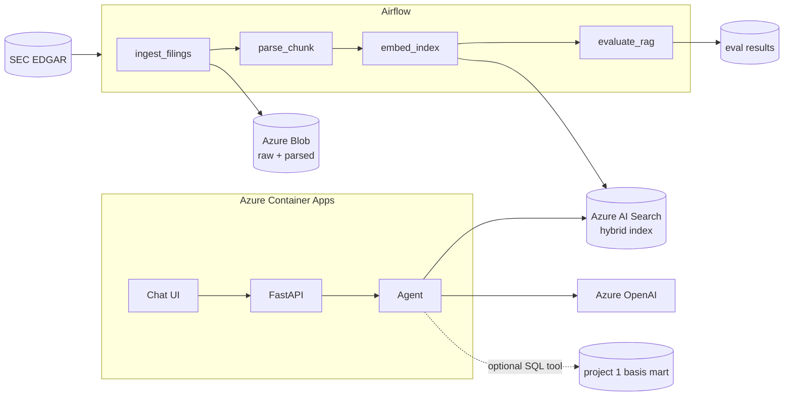

# grid-disclosure-copilot

> **Status: architecture only.** This directory holds the design and an empty
> skeleton. No pipeline or application code exists yet. Everything under
> "Planned" is a plan.

A cited question-answering copilot over the SEC filings of power companies
active in Texas. It answers questions like *"What do the large ERCOT
generators say about winter-storm and market-rule risk, and how has that
language changed since 2021?"* with every claim linked to a filing, section,
and passage.

**Closes:** Azure · RAG / agents · Airflow / orchestration
**Dataset:** [SEC EDGAR](https://www.sec.gov/edgar) filings (10-K, 10-Q, 8-K)
for a chosen set of ERCOT-active generators and retailers
**Helps:** Climate ML engineer · Sustainability data engineer

## Why this project

Sustainability and energy teams spend real time reading disclosures. A system
that retrieves precisely, cites faithfully, and says "the filings don't
address that" when they don't is a better demonstration of RAG skill than a
chatbot that answers everything. The project's centre of gravity is therefore
the **evaluation harness**, not the chat UI.

## Planned architecture (summary)

Details, decisions still open, and cost are in
[`ARCHITECTURE.md`](ARCHITECTURE.md).

## Planned deliverables

- [ ] Airflow DAGs: ingest → parse → index → evaluate, idempotent and backfillable
- [ ] Hybrid retrieval over structure-aware chunks, with citations
- [ ] Agent with a read-only SQL tool and prompt-injection guardrails
- [ ] Golden-set evaluation: retrieval recall, citation precision, faithfulness, abstention
- [ ] Bicep-deployed Azure stack with managed identity and a teardown script
- [ ] `reports/writeup.md` and a demo (hosted, or screenshots + recorded run)

## Planned 3-week milestones

| Week | Goal | Exit criteria |
| --- | --- | --- |
| 1 | Ingest, parse, index baseline | 5-8 companies indexed; a question returns cited passages from a CLI; Bicep stands up Blob + AI Search + OpenAI |
| 2 | API, agent, UI, Airflow | `/ask` endpoint on Container Apps; DAGs run on a schedule locally; SQL tool behind an allowlist |
| 3 | Evaluation and write-up | Golden set of 40-60 questions with metrics; baseline vs agent compared; write-up, screenshots, teardown verified |

## Planned layout

| Path | Contents |
| --- | --- |
| `airflow/dags` | DAG definitions (and a local Docker Compose for Airflow) |
| `src/ingest` | EDGAR client: discover filings, fetch, rate-limit |
| `src/parse` | HTML to sections and chunks |
| `src/index` | Embedding and idempotent index upserts |
| `src/retrieval` | Hybrid query, filters, reranking |
| `src/agent` | Tool-using loop, tools, guardrails |
| `src/evals` | Metrics and judge code |
| `src/api` | FastAPI service |
| `app` | Chat UI |
| `infra/bicep` | Azure infrastructure |
| `evals/golden` | Hand-written questions and expected sources |
| `data/sample` | Small committed fixture (a few filings' worth of chunks) |
| `docs/decisions` | ADRs |
| `reports` | Write-up |

Assumptions and methodology are recorded in [`ASSUMPTIONS.md`](ASSUMPTIONS.md).
Shared rules: [`../docs/portfolio/CONVENTIONS.md`](../docs/portfolio/CONVENTIONS.md).
