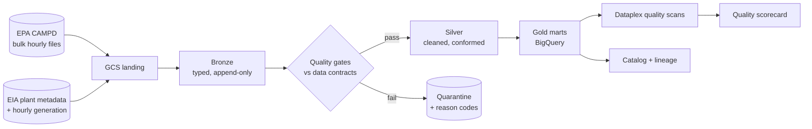

# grid-emissions-lakehouse

> **Status: architecture only.** This directory holds the design and an empty
> skeleton. No pipeline code exists yet. Everything under "Planned" is a plan.

A governed medallion pipeline (bronze → silver → gold) over U.S. power-plant
hourly emissions, built with Spark on Google Cloud, where **data quality and
governance are the product**: machine-readable data contracts, quarantined
bad rows with reason codes, quality scans, lineage, and a published quality
scorecard.

**Closes:** Spark · Data quality / governance · GCP
**Dataset:** [EPA CAMPD](https://campd.epa.gov/) hourly emissions from
continuous emissions monitoring (CEMS), joined to EIA plant metadata and EIA
hourly generation
**Helps:** Climate ML engineer · Sustainability data engineer

## Why this project

Emissions data is where "data quality" has real consequences: unit
conversions, substituted values when a monitor is down, local-time hours,
plants that change identifiers. A pipeline that detects and explains those
problems, rather than just moving rows, is the skill being shown. The
write-up also asks an honest question: *is Spark the right tool here?* and
answers it with a measured Spark-vs-BigQuery comparison.

## Planned architecture (summary)

Spark jobs run on Dataproc Serverless, with local `pyspark` for development
and CI. Details, open decisions, and cost are in
[`ARCHITECTURE.md`](ARCHITECTURE.md).

## Planned deliverables

- [ ] Bronze/silver/gold PySpark jobs, runnable locally on a sample and on GCP at scale
- [ ] YAML data contracts, validated in CI, driving the quality gates
- [ ] Quarantine tables with reason codes, and a rejection-rate report
- [ ] BigQuery gold marts with Dataplex quality scans, catalog entries, and lineage
- [ ] Terraform for buckets, datasets, service accounts, scans, and a budget alert
- [ ] Spark-vs-BigQuery benchmark and an "is Spark justified?" ADR
- [ ] Quality scorecard (published page or screenshots), `reports/writeup.md`

## Planned 3-week milestones

| Week | Goal | Exit criteria |
| --- | --- | --- |
| 1 | Landing, bronze, contracts | Sample month lands and types correctly; contracts validate in CI; Spark tests run locally with no GCP |
| 2 | Silver gates, gold, BigQuery, Terraform | Rejects quarantined with reasons; gold marts load to BigQuery; `terraform apply` and `destroy` both work |
| 3 | Governance, benchmark, write-up | Dataplex scans and lineage working; benchmark table; scorecard; write-up and screenshots |

## Stretch goal

A weather-driven baseline forecast of hourly carbon intensity (features from
public weather data, honest time-based backtest against a naive baseline).
Only after the core is done; it is the main place this portfolio shows
predictive modeling.

## Planned layout

| Path | Contents |
| --- | --- |
| `src/spark_jobs/{bronze,silver,gold}` | PySpark jobs per layer |
| `src/quality` | Contract loader, gate checks, quarantine writer |
| `contracts` | One YAML data contract per table |
| `sql` | BigQuery DDL and mart definitions |
| `infra/terraform` | GCP infrastructure |
| `orchestration` | Job submission and scheduling (CI workflow / Cloud Workflows) |
| `data/sample` | Small committed fixture (one state-month) |
| `docs/decisions` | ADRs |
| `reports` | Write-up and scorecard |

Assumptions and methodology are recorded in [`ASSUMPTIONS.md`](ASSUMPTIONS.md).
Shared rules: [`../docs/portfolio/CONVENTIONS.md`](../docs/portfolio/CONVENTIONS.md).
